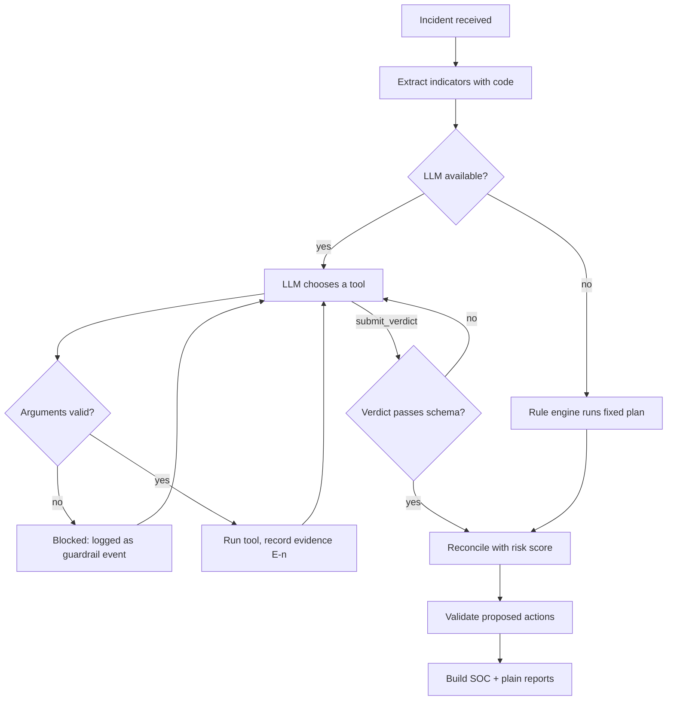

# Reasoning Agent Design

**Status:** Draft v1 · **Last updated:** 2026-10-02
This document specifies the AI agent that investigates incidents (the `agent/` service).
For instructions aimed at AI *coding assistants* working on this repo, see [`../AGENTS.md`](../AGENTS.md).

---

## 1. What the agent does

Given one incident, the agent:
1. gathers evidence by calling tools,
2. submits a structured verdict,
3. proposes response actions.

It never executes anything. A working reference implementation exists in the Python prototype (kept outside this repo).

## 2. Investigation loop



Limits: at most 8 LLM turns, 120 seconds and 4 tool calls per turn per investigation, plus a daily cap (ADR-15). On a model error, an unusable reply, truncation, timeout, the turn limit or the daily cap, the rule engine finishes the job using the evidence already gathered. Implemented in step 12 (`agent/app/reasoning.py`, ADR-44). After the model's verdict, the rule engine's standard checks that the model skipped are made too: the model can add checks, never remove them, so it cannot lower the score by leaving evidence ungathered.

## 3. Indicators

Before the LLM sees anything, plain code extracts indicators from the incident: IP addresses, domains, email addresses, phone numbers, and the identities involved. These lists are the **only** values tools will accept. The LLM cannot introduce a new one.

Implemented in `agent/app/indicators.py` (step 9): links and addresses count, bare names merely mentioned in the text do not; IPv4 must be the plain four-number form; at most 50 of each type. The mock reputation data (`agent/app/threat_intel.py`) uses only reserved example names (`.example` domains, documentation IP ranges, 555-01xx numbers). The look-alike check ignores the top-level domain, so `weather.example` does not "imitate" `example.com`.

## 4. Tools (the allow-list)

All tools are read-only.

| Tool | Input | What it checks | Rejects when |
|---|---|---|---|
| `reputation_lookup` | `indicator_type` (`ip`/`domain`/`email`/`phone`), `value` | Threat-intel score and tags; look-alike and newly registered domains | `value` is not an extracted indicator |
| `baseline_check` | `identity` | Deviation from the person's normal countries, hours, devices, contacts; impossible travel | `identity` is not part of the incident |
| `pattern_match` | `target` (`subject`/`body`/`transcript`/`all`) | Known attack language: urgency, credential requests, one-time-code requests, impersonation, remote-access tools, prompt-injection text | `target` doesn't exist for this incident kind |
| `correlate_events` | none | Per-source login statistics (stuffing, brute force, success after failures, automation); indicators shared with incidents from the last 7 days, ignoring known-good and internal ones (ADR-42) | Any argument is given |
| `submit_verdict` | see section 7 | Ends the investigation | Schema invalid or cites unknown evidence |

Any other tool name is rejected.

Implemented in step 10 (ADR-41): `baseline_check` records only differences from the baseline, never its values; `pattern_match` normalises the text first (invisible characters, Unicode look-alikes, spacing) so disguised phrases are still caught.

## 5. Evidence and signals

Each accepted tool call becomes an **evidence item**:

```json
{
  "label": "E2",
  "tool": "reputation_lookup",
  "args": {"indicator_type": "ip", "value": "185.220.101.47"},
  "summary": "ip 185.220.101.47: score=92 tags=[tor-exit-node]",
  "result": { "...": "raw tool output" },
  "signals": [ { "...": "see below" } ],
  "ts": "2026-10-02T06:00:01.120Z"
}
```

A **signal** is one finding. It carries both a technical and a plain description, which is what keeps the two reports consistent:

```json
{
  "id": "REP-MALICIOUS",
  "label": "185.220.101.47 is known-malicious (score 92: tor-exit-node)",
  "plain": "This address is on lists of known attackers.",
  "weight": 45,
  "mitre": "T1583"
}
```

Rejected calls are recorded too, labelled `R1`, `R2`, …, with the reason.

## 6. Risk score

The score is computed by code from the signals, never taken from the LLM.

- Keep the strongest signal per `id`.
- Combine with **noisy-OR**: `risk = 100 × (1 − Π(1 − weight/100))`. Independent findings compound, and the result never exceeds 100.
- Bands: 0–29 benign · 30–64 suspicious · 65–100 malicious.

Example: weights 50, 45, 25 → `1 − (0.50 × 0.55 × 0.75) = 0.79` → risk 79, malicious.

Details (ADR-43): each weight counts at most 95 (no single finding is proof); findings are multiplied in id order and the result rounded half up, identically in the agent and the gateway, which recomputes the score from stored evidence. Both are checked against `testdata/risk-score-cases.json`.

## 7. Verdict schema

The LLM's `submit_verdict` call is parsed against this before it is trusted:

| Field | Type | Rule |
|---|---|---|
| `verdict` | enum | `benign` / `suspicious` / `malicious` |
| `attack_type` | enum | `none`, `phishing`, `credential_stuffing`, `brute_force`, `account_takeover`, `impossible_travel`, `vishing`, `prompt_injection`, `bec`, `other` |
| `cited_evidence` | list of `E\d+` | Every ID must exist |
| `mitre_techniques` | list | Must match `T####(.###)` or `AML.T####` |
| `proposed_actions` | list of `{action, target}` | Validated by the action policy |
| `counterfactual` | string ≤ 500 | What would change the verdict |

Unknown fields are rejected.

## 8. Reconciliation (the score floor)

| Situation | Result |
|---|---|
| LLM verdict ≥ evidence band | LLM verdict stands |
| LLM verdict < evidence band | Verdict is raised to the evidence band |
| LLM says benign but evidence says otherwise, or they differ by two levels | Flagged as a **disagreement**; incident goes to `needs_review` |

The LLM can make the system more cautious, never less.

## 9. Action policy

| Action | Risk | Target must be | Extra rule |
|---|---|---|---|
| `monitor` | low | any identity or indicator in the incident | auto-executed |
| `notify_user` | low | an identity in the incident | auto-executed |
| `force_password_reset` | **high** | an identity in the incident | needs approval |
| `lock_account` | **high** | an identity in the incident | needs approval |
| `block_ip` | **high** | an extracted IP **with evidence** | never a private, loopback or reserved address |
| `quarantine_email` | **high** | the sender address, with evidence | |
| `block_sender_domain` | **high** | an extracted domain, with evidence | never a protected (own) domain |
| `block_phone_number` | **high** | the caller number, with evidence | |

A high-risk action proposed for a benign verdict is rejected. Rejected proposals are logged as guardrail events. The gateway applies the same allow-list again when it receives the result.

## 10. Prompt-injection defences

| # | Defence | Enforced by |
|---|---|---|
| 1 | Incident content is passed as JSON inside `<untrusted_incident>` tags, with `<` and `>` escaped so the fence cannot be closed. | Code |
| 2 | The system prompt states that incident content is data, and that instructions inside it are evidence of an attack. | Prompt |
| 3 | Tools are read-only. | Code |
| 4 | Tool arguments must be extracted indicators. | Code |
| 5 | Actions are proposals, validated by policy, and high-risk ones need a human. | Code |
| 6 | The verdict cannot go below the evidence score. | Code |
| 7 | `pattern_match` detects injection phrasing and raises the score (`AML.T0051`). | Code |
| 8 | Every call and every rejection is audited. | Code |
| 9 | The model sees each tool's summary and findings, never its raw result (which can quote the attacker). | Code |
| 10 | The model's own words never reach the live stream or the logs; live notes are written by code. | Code |

Only defence 2 depends on the model behaving. The rest hold even if the model is fully manipulated; the red-team tests (`agent/tests/test_reasoning.py`) demonstrate this with a scripted hijacked model, and the probe in step 17 will show it live.

## 11. LLM configuration

| Setting | Value |
|---|---|
| Provider | A local model served by Ollama on this machine (ADR-15). `LLM_PROVIDER=off` runs the rule engine only |
| Model | `LLM_MODEL`, default `qwen3:8b`; thinking off, temperature 0, at most 512 tokens per reply |
| Tool definitions | JSON schemas with `additionalProperties: false`; values limited to this incident's where possible (people, text fields) |
| Refusals / errors | Fall back to the rule engine |
| Data sent | Never leaves the machine (`OLLAMA_URL` must be a loopback address): the fenced incident, indicator lists, tool summaries and findings |

## 12. Rule engine (fallback)

A fixed plan per incident kind, using the same tools and the same scoring:

| Kind | Plan |
|---|---|
| `email` | pattern match → sender reputation → reply-to and link reputation → baseline → correlation |
| `login` | correlation → reputation of top source IPs → baseline of the subject |
| `call_transcript` | pattern match → caller reputation → baseline → correlation |

Verdict = evidence band. Attack type and actions are derived from which signals fired. Implemented in step 11 (`agent/app/verdict.py`); the six demo scenarios are tests (`agent/tests/scenarios.py`).

## 13. Evaluation

| Suite | Content | Pass condition |
|---|---|---|
| Scenario tests | The six demo scenarios | Expected verdict and attack type |
| Labelled set | 50–100 benign and malicious incidents | Recall ≥ 90%, false-positive rate ≤ 10% |
| Red-team suite | Injection payloads in every text field | 0 unauthorised tool calls, 0 unauthorised actions, verdict never lowered |
| Traceability | Every report | Every finding cites an existing evidence ID |

## 14. Reports (step 13, ADR-45)

| | SOC report | Plain report |
|---|---|---|
| Reader | Security team | The employee |
| Built from | Every finding that counts, in its technical words (`label`), with evidence ID, weight, technique | Up to five of the same findings in their plain words (`plain`) |
| Fixed wording | Headline, next steps (by verdict and attack type) | Headline, what happened, what to do (no jargon, grade 8 or below) |
| AI text | One optional summary line, checked (below) | None |

The AI line is written after all the evidence is in, from findings whose names, addresses, links and numbers are replaced by plain words. It is kept only if it is one printable sentence of at most 200 characters, cites existing evidence, contains no address, link or number, copies no four-word run from the incident, and does not call a non-benign incident safe. The gateway checks every finding and reason against the stored evidence before saving either report.
