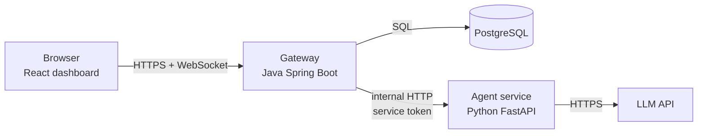
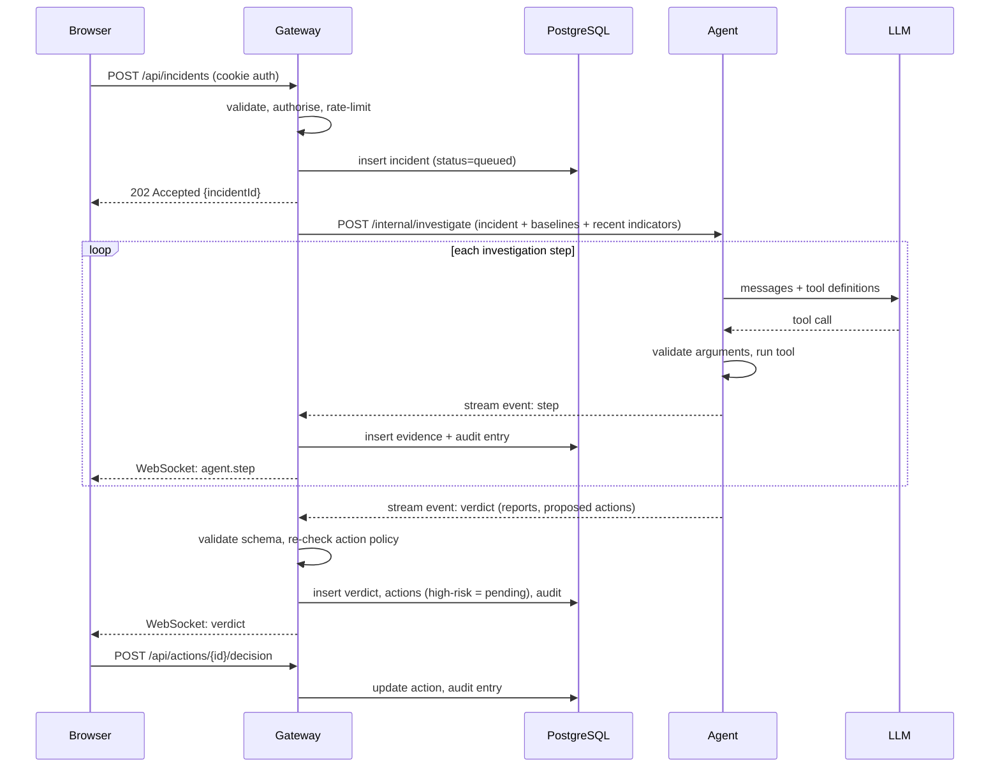
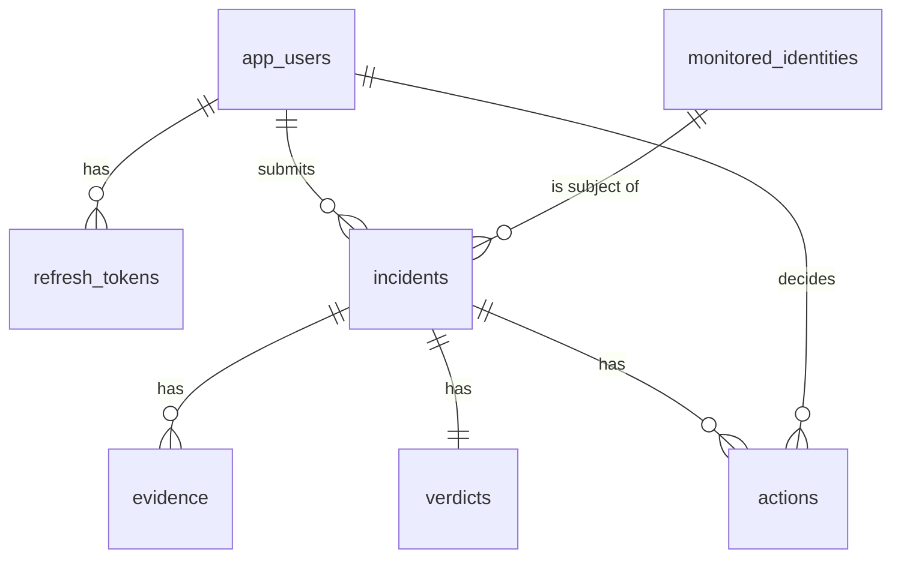

# Architecture

**Status:** Draft v1 · **Last updated:** 2026-10-02
Decisions referenced as ADR-n are recorded in [`DECISIONS.md`](DECISIONS.md).

---

## 1. System overview



There are three services and one database. Only the **gateway** is reachable from the browser.

| Component | Tech | Responsibility | Never does |
|---|---|---|---|
| **Dashboard** | React, TypeScript, Vite, D3 | Shows incidents, the live investigation, both reports, the approval screen. | Hold secrets; decide anything about security. |
| **Gateway** | Java 25, Spring Boot 4, Spring Security | The only public entry point. Authentication, authorisation, rate limiting, validation, incident storage, approvals, audit log, WebSocket. **Owns the database.** | Call the LLM. |
| **Agent** | Python 3, FastAPI | Runs one investigation: tools, LLM loop, guardrails, risk score, both reports. **Stateless.** | Touch the database; accept traffic from browsers; execute actions. |
| **PostgreSQL** | v16 | All persistent data. | |

### Why split it this way

- **The gateway owns all data and all authority (ADR-3).** The agent receives everything it needs in the request and returns results. It has no database credentials. If the LLM is manipulated, the worst it can do is return a bad answer, which the gateway validates before storing.
- **The agent is the only part that sees attacker-controlled text next to an LLM.** Keeping it small, stateless and isolated limits what a successful attack can reach.
- **Java for the perimeter, Python for the AI (ADR-1).** Spring Security is mature for auth and hardening; Python has the best LLM tooling.

## 2. Request flow: one investigation



The gateway never trusts the agent's output: it parses it against a schema and re-applies the action allow-list before anything is saved (ADR-5).

## 3. Repository layout

```
.
├── gateway/        Spring Boot app (Maven)
│   └── src/main/java/com/securityanalyst/gateway/
│       ├── health/       health endpoint
│       ├── auth/         signup, login, tokens, roles
│       ├── incident/     ingestion, listing, detail
│       ├── agent/        client that calls the agent service
│       ├── action/       proposed actions, approvals
│       ├── audit/        hash-chained audit log
│       ├── realtime/     WebSocket
│       └── common/       error handling, validation, rate limiting, security config
├── agent/          Python FastAPI service
│   └── app/
│       ├── main.py       internal API
│       ├── tools.py      the allow-listed tools
│       ├── guardrails.py argument + action validation
│       ├── scoring.py    risk score
│       ├── explain.py    SOC + plain reports
│       ├── llm.py        LLM loop
│       └── rules.py      fallback rule engine
├── dashboard/      React app
├── docs/           this folder
├── AGENTS.md       instructions for AI coding assistants
├── README.md
└── SECURITY.md
```

Packages are organised **by feature**, not by layer, so everything about one feature lives together.

## 4. Data model

All tables live in PostgreSQL and are created by Flyway migrations in `gateway/src/main/resources/db/migration`.



| Table | Purpose | Key columns |
|---|---|---|
| `app_users` | People who log in to the product (analysts). | `id`, `username` (unique), `password_hash`, `role`, `created_at` |
| `refresh_tokens` | Rotating refresh tokens. Only a hash is stored. | `token_hash`, `user_id`, `expires_at`, `revoked_at`, `replaced_by` |
| `monitored_identities` | Employees the product protects, with their baseline. **Not** the same as `app_users`. | `identity` (e.g. `priya.sharma`), `display_name`, `baseline` (AES-256-GCM encrypted bytes, ADR-37), `created_at` |
| `incidents` | One suspicious event. | `id`, `kind`, `subject_identity`, `payload` (JSONB, the validated request), `status`, `source`, `created_by`, `created_at`. Planned: `indicators` (step 9), `engine` (step 12) |
| `evidence` | One row per agent tool call. | `id`, `incident_id`, `label` (E1, E2…), `tool`, `args`, `result`, `status` (`ok`/`rejected`), `created_at` |
| `verdicts` | Final outcome of an investigation. | `incident_id`, `verdict`, `attack_type`, `risk_score`, `engine`, `disagreement`, `soc_report`, `plain_report` |
| `actions` | Proposed response actions and their lifecycle. | `id`, `incident_id`, `action`, `target`, `risk`, `status` (`pending`/`executed`/`rejected`/`expired`), `proposed_by`, `decided_by`, `decided_at`, `reason` |
| `enforcement` | What the (simulated) enforcement layer has done. | `id`, `action_id`, `action`, `target`, `created_at` |
| `audit_log` | Tamper-evident history. | `seq`, `ts`, `actor`, `event`, `incident_id`, `data`, `prev_hash`, `hash` |

Incident status: `queued → investigating → awaiting_approval | needs_review | closed | error`.

## 5. API surface

### 5.1 Public API (gateway, HTTPS on port 8443)

All responses are JSON. Errors use one shape: `{"error": "...", "fields": {...}, "traceId": "..."}` (`fields` only for validation errors). Every response carries an `X-Trace-Id` header that matches the `traceId` and the server log lines for that request.

| Method | Path | Role | Purpose |
|---|---|---|---|
| GET | `/api/health` | none | Liveness check |
| POST | `/api/auth/signup` | none | Create account |
| POST | `/api/auth/login` | none | Log in, set cookies |
| POST | `/api/auth/refresh` | cookie | Rotate tokens |
| POST | `/api/auth/logout` | any | Revoke refresh token |
| GET | `/api/me` | any | Current user |
| GET | `/api/admin/users` | ADMIN | List users |
| PUT | `/api/admin/users/{id}/role` | ADMIN | Change a user's role (never one's own) |
| POST | `/api/incidents` | ANALYST+ | Submit an incident (`202 Accepted`, investigation queued) |
| GET | `/api/incidents` | any | List incidents |
| GET | `/api/incidents/{id}` | any | Incident + evidence + verdict + actions |
| POST | `/api/actions/{id}/decision` | ANALYST+ | Approve or reject |
| GET | `/api/audit` | any | Recent audit entries |
| GET | `/api/audit/verify` | any | Check the hash chain |
| POST | `/api/demo/{scenario}` | ANALYST+ | Fire a simulated incident |
| WS | `/ws` | any | Live event stream |

### 5.2 Internal API (agent, port 8001, bound to localhost)

| Method | Path | Purpose |
|---|---|---|
| GET | `/internal/health` | Liveness |
| POST | `/internal/investigate` | Run one investigation; response is a stream of newline-delimited JSON events |

Every internal request carries `Authorization: Bearer <AGENT_SERVICE_TOKEN>`. The agent rejects anything without it.

### 5.3 Event types (agent → gateway → browser)

| Event | Meaning |
|---|---|
| `incident.created` / `incident.status` | Lifecycle changes |
| `agent.thought` | Short narration of what the agent is about to do |
| `agent.step` | A completed tool call (an evidence item) plus the running risk score |
| `agent.guardrail` | A tool call or action that was **blocked**, with the reason |
| `verdict` | Final verdict available |
| `investigation.complete` | (agent → gateway) Last line of every investigation; carries the status the incident moves to. Step 8 sends `needs_review` with engine `stub`. |
| `action.decided` | A human approved or rejected an action |

## 6. Security architecture (summary)

Full detail in [`THREAT_MODEL.md`](THREAT_MODEL.md) and `SECURITY.md`.

| Layer | Controls |
|---|---|
| Browser → Gateway | TLS, HttpOnly/Secure/SameSite cookies, CSRF protection, CSP and security headers, rate limiting, strict validation |
| Gateway | Role checks on every endpoint, object-level checks, generic errors with trace IDs, audit log |
| Gateway → Agent | Localhost-only binding, service token, schema validation of everything returned |
| Agent | Incident text fenced as data, read-only tool allow-list, arguments limited to values extracted from the incident, action policy, turn and time limits |
| Data | Argon2 password hashes, hashed tokens, encrypted baselines, HMAC-chained audit log |

## 7. Configuration and secrets

Nothing secret is committed. Each service reads environment variables; a `.env.example` documents the names.

| Variable | Used by | Purpose |
|---|---|---|
| `DB_URL`, `DB_USER`, `DB_PASSWORD` | gateway | PostgreSQL connection |
| `JWT_SIGNING_KEY` | gateway | Signs access tokens (32+ random bytes, Base64; created by `scripts\setup-secrets.ps1`) |
| `AUDIT_HMAC_KEY` | gateway | Keys the audit chain |
| `BASELINE_ENCRYPTION_KEY` | gateway | Encrypts baselines at rest (exactly 32 random bytes, Base64; created by `scripts\setup-secrets.ps1`) |
| `AGENT_SERVICE_TOKEN` | gateway, agent | Authenticates gateway → agent calls (32+ random bytes, Base64; created by `scripts\setup-secrets.ps1`; both read it from `.env`) |
| `ANTHROPIC_API_KEY` | agent | LLM access (optional; without it the rule engine runs) |
| `SECURITY_RATELIMIT_*` (optional) | gateway | Override the rate-limit thresholds set in `application.properties`, e.g. `SECURITY_RATELIMIT_REQUESTSPERMINUTE` |

## 8. Local development

| Service | Port | Start command |
|---|---|---|
| Gateway | 8443 (HTTPS only) | `cd gateway && ./mvnw spring-boot:run`. Needs the certificate from `scripts\setup-https.ps1` |
| Agent | 8001 (127.0.0.1 only) | `cd agent; .\.venv\Scripts\python.exe -m uvicorn app.main:app --host 127.0.0.1 --port 8001 --no-server-header` |
| Dashboard | 5173 | `cd dashboard && npm run dev` |
| PostgreSQL | 5432 | Windows service `postgresql-x64-16`. Database `secanalyst`, role `secanalyst_app`, created once by `scripts\setup-db.ps1` |

## 9. Testing strategy

| Level | Tool | What it covers |
|---|---|---|
| Gateway unit / slice | JUnit 6, MockMvc | Controllers, validation, security rules |
| Gateway integration | Spring Boot test + embedded PostgreSQL 16 (started by the tests, ADR-16) | Migrations, repositories, auth flows |
| Agent unit | pytest | Tools, guardrails, scoring, reports |
| Agent scenarios | pytest | Each demo scenario reaches the expected verdict with the rule engine |
| Red-team suite | pytest | Injection payloads never cause an unauthorised tool call or action |
| Dashboard | Vitest + Testing Library | Components render untrusted text safely |
| End to end | Script against running services | Submit → investigate → approve → audit verifies |
| CI | GitHub Actions (`.github/workflows/ci.yml`) | Gateway tests on every pull request and push to `main` (since step 5a); more suites, dependency audit and static analysis added as they arrive |
